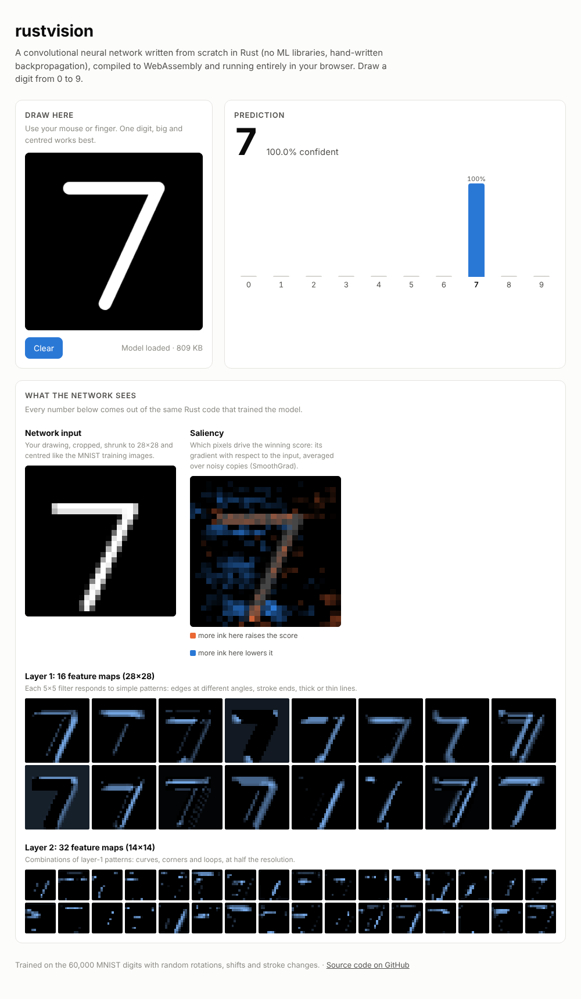

# rustvision

**A convolutional neural network built from scratch in pure Rust, with zero dependencies and hand-written backpropagation. It compiles to WebAssembly so you can draw a digit and watch it think, live in your browser.**

### ▶ [Try the live demo](https://isaac2018brenner.github.io/rustvision/)




`Cargo.toml` has an empty `[dependencies]` section. Convolutions, max pooling, the dense layers, backpropagation, the Adam optimizer, data augmentation, multithreaded training and the WebAssembly interface are all written by hand in about 1,000 lines of Rust. It reaches **99.38% test accuracy on MNIST** after 5 minutes of training on a laptop CPU.

## The demo

The [demo page](https://isaac2018brenner.github.io/rustvision/) runs the trained network in your browser through a 53 KB WebAssembly module, with no server involved. As you draw, it shows:

- **The prediction** and the probability for every digit, updated on every stroke.
- **The network input**: your drawing cropped, shrunk to 28×28 and centred by its centre of mass, the same way the MNIST images were prepared.
- **A saliency map**: the gradient of the winning score with respect to every input pixel, computed by running backpropagation all the way back to the image. Orange pixels would raise the score if you added ink there; blue ones would lower it. It uses SmoothGrad (averaging over 16 noisy copies) to remove speckle.
- **All 48 feature maps**: what each of the 16 first-layer filters and 32 second-layer filters responds to in your drawing.

## Quick start

```bash
git clone https://github.com/isaac2018brenner/rustvision && cd rustvision
./scripts/download_mnist.sh               # 60,000 training + 10,000 test digits

export RUSTFLAGS="-C target-cpu=native"   # let the compiler use your CPU's vector instructions
cargo run --release -- train              # ~5 min on 4 cores, writes model.bin
cargo run --release -- eval               # accuracy + confusion matrix
cargo run --release -- show --count 3     # digits as text art, with predictions
```

Skip training and use the trained model from the demo by adding `--model docs/model.bin` to `eval` or `show`.

To run the demo locally with your own model:

```bash
./scripts/build_web.sh                    # builds the .wasm and copies it + model.bin into docs/
python3 -m http.server -d docs 8000       # then open http://localhost:8000
```

### In the terminal

```
                                ==@@@@%%
                            ..**@@@@##::
                          ..%%@@@@++
                          ##@@@@++
                        ::@@@@**
                      ::@@@@##
                    ..##@@@@==
                    ::@@@@++                               test image #3978, true label 6
                    ==@@@@::..::----..
                  ::%%@@##  ##@@@@@@%%==                   6  100.0%  ██████████████████████████████
                  ==@@@@..  **--    ##@@**                 0    0.0%
                  ##@@@@..          **@@##                 5    0.0%
                ::@@@@@@..          **@@##
                ::@@@@**            **@@##
                ::@@@@**          ::%%@@##
                  ##@@%%        ..%%@@@@++
                  ==@@@@::    ..##@@@@%%..
                  ::%%@@%%::::##@@@@##..
                    ..##@@@@@@@@@@##::
                        ++##@@++::
```

## The network

```
input 1×28×28
  │
  ├─ Conv 5×5, 16 filters, padding 2 ─ ReLU ─ MaxPool 2×2   →  16×14×14
  ├─ Conv 3×3, 32 filters, padding 1 ─ ReLU ─ MaxPool 2×2   →  32×7×7
  ├─ Dense 1568 → 128 ─ ReLU
  └─ Dense 128 → 10 ─ softmax
                                               207,178 parameters
```

Layers are a plain Rust `enum`, and shapes are inferred when the network is built, so the architecture in `Net::mnist()` reads like the diagram above.

| File | What's in it |
|---|---|
| [`src/net.rs`](src/net.rs) | The layers, with forward **and backward** passes for convolution, max pooling, ReLU and dense layers; saliency; tests |
| [`src/augment.rs`](src/augment.rs) | Random rotation, scaling, shear and shifts (bilinear warping), plus stroke thickening and thinning |
| [`src/optim.rs`](src/optim.rs) | Adam |
| [`src/main.rs`](src/main.rs) | CLI: `train`, `eval`, `show`, with multithreaded mini-batches |
| [`src/wasm.rs`](src/wasm.rs) | The browser interface: plain `extern "C"` functions and shared memory buffers, no wasm-bindgen |
| [`src/mnist.rs`](src/mnist.rs) | Reader for MNIST's IDX file format |
| [`docs/index.html`](docs/index.html) | The demo page: drawing, MNIST-style preprocessing and visualizations in vanilla JavaScript |

### Some details

- **Convolution as row-wise multiply-adds.** For each kernel offset, the convolution adds a scaled, shifted row of the input into a row of the output. The inner loop is a contiguous `y += w * x`, which the compiler turns into SIMD instructions, with no im2col buffer needed.
- **Verified by finite differences.** The test suite nudges *every* weight in a small network, and every input pixel, and checks that the hand-derived gradients match `(L(θ+ε) − L(θ−ε)) / 2ε`. A deliberately planted bug in the convolution backward pass makes the test fail.
- **Data augmentation for real handwriting.** MNIST digits are neat and centred; mouse-drawn ones aren't. Every training image gets a random rotation (±15°), scale (±15%), shear, shift (±2.5 px) and, sometimes, a thicker or thinner stroke, so the network sees a slightly different digit each epoch.
- **Parallel training without locks.** Each mini-batch is split across threads; every thread accumulates gradients into its own buffer, and the buffers are summed before the Adam step.
- **One set of weights, two targets.** The same `Net` code and `model.bin` file run natively for training and in WebAssembly for the demo.

## Results

Default settings (`rustvision train`): 10 epochs, batch 64, Adam with cosine learning-rate decay, measured on a 4-thread cloud VM.

| | |
|---|---|
| Test accuracy | **99.38%** (62 of 10,000 test digits wrong) |
| Training time | 5.2 min total, ~30 s per epoch, ~2,000 images/s |
| Parameters | 207,178 (809 KB on disk) |
| WebAssembly module | 53 KB |

<details>
<summary>Test accuracy after each epoch</summary>

| Epoch | Test accuracy |
|---|---|
| 1 | 98.85% |
| 2 | 99.04% |
| 3 | 99.17% |
| 4 | 99.23% |
| 5 | 99.24% |
| 6 | 99.32% |
| 7 | 99.25% |
| 8 | 99.31% |
| 9 | 99.31% |
| 10 | 99.38% |

</details>

`rustvision eval` prints a confusion matrix, which shows exactly which digits get mixed up. The most common mistake is a 9 read as a 4:

```
test accuracy: 99.38% (9938 / 10000)

confusion matrix (rows: true digit, columns: predicted)

          0    1    2    3    4    5    6    7    8    9
   0    975    .    .    .    .    1    2    1    1    .    99.49%
   1      . 1129    1    .    1    .    1    3    .    .    99.47%
   2      1    . 1025    1    .    .    .    5    .    .    99.32%
   3      .    .    . 1006    .    3    .    .    1    .    99.60%
   4      .    .    .    .  980    .    .    .    .    2    99.80%
   5      .    .    .    4    .  887    1    .    .    .    99.44%
   6      4    2    .    .    1    .  949    .    2    .    99.06%
   7      .    2    1    1    .    .    . 1023    1    .    99.51%
   8      .    .    3    .    .    1    .    .  970    .    99.59%
   9      .    .    .    .    8    2    .    4    1  994    98.51%
```

The full training log is in [`assets/train.log`](assets/train.log).

## Tests

```bash
cargo test --release
```

- `gradients_match_finite_differences`: checks every parameter gradient and the input gradient numerically.
- `can_overfit_a_few_examples`: the full training loop can memorize a small batch.
- `shapes_are_inferred`: layer shapes and the parameter count of the MNIST network.
- `identity_warp_is_a_no_op`, `shift_moves_pixels`: the augmentation geometry is correct.

CI runs `rustfmt`, `clippy -D warnings`, the tests, and the WebAssembly build on every push.

## Ideas for extending it

- Batch normalization and dropout
- Train on [Fashion-MNIST](https://github.com/zalandoresearch/fashion-mnist) (it uses the same file format, so it's a drop-in swap) or on letters (EMNIST)
- Grad-CAM heatmaps from the last convolutional layer
- An "adversarial example" button that nudges your drawing until the network changes its mind

## License

MIT. MNIST is by Yann LeCun, Corinna Cortes and Christopher Burges.
